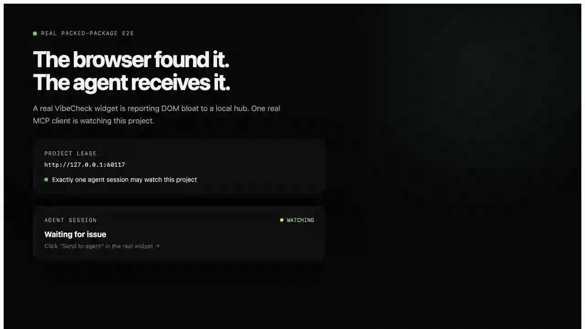

# vibe-check

[](https://coderabbit.ai)

**Perf + SEO monitor that hands browser findings to your coding agent — then
verifies the fix.**

It runs in your app, catches the issues vibe-coded sites ship with — janky frames,
DOM bloat, duplicate fetches, memory leaks, unoptimized images, missing SEO/AEO
basics — and can send a detected issue to the one AI-agent session that owns
that project. A fix counts only when fresh browser snapshots stop showing the
issue. Use it as a last check before you call the frontend done.



This is the packed-package E2E, not a scripted UI: the real widget detects DOM
bloat, a real MCP SDK client leases the project, and **Send to agent** delivers
the issue before the receipt turns green. It was recorded with the 0.3 widget,
so some labels differ from 0.4.

## Packages

| Package | npm | Description |
|---------|-----|-------------|
| [`@wcgw/vibe-check-core`](./packages/core) | [](https://www.npmjs.com/package/@wcgw/vibe-check-core) | Framework-agnostic monitoring engine (zero deps) |
| [`@wcgw/vibe-check`](./packages/react) | [](https://www.npmjs.com/package/@wcgw/vibe-check) | React overlay widget |
| [`@wcgw/vibe-check-mcp`](./packages/mcp) | [](https://www.npmjs.com/package/@wcgw/vibe-check-mcp) | MCP server bridging browser metrics to AI agents |

## Framework support

The overlay widget ships **for React 18+ today** (`@wcgw/vibe-check`, which
peer-depends on React). The engine underneath it — `@wcgw/vibe-check-core` — is
framework-agnostic with **zero runtime dependencies**, so you can run the exact
same collectors and detectors headless in any (or no) framework and render your
own UI. Vue/Svelte/vanilla widget adapters are not built yet; the core API below
is the supported path until they are.

## Quick start (React)

From an existing React project, scaffold the widget and one supported agent in
one command:

```bash
npx -y @wcgw/vibe-check-mcp@latest setup --agent codex --project my-storefront
```

Use `claude-code` or `cursor` instead of `codex` for those clients. The command
detects your package manager, installs the matching widget version, creates
`src/VibeCheckDevtools.tsx` (or a root-level file when there is no `src/`), and
configures the selected MCP client without deleting existing Cursor servers.
Mount `<VibeCheckDevtools />` once near the app root, then follow the printed hub
and watch steps. Preview every action without changing anything with `--dry-run`.

The equivalent manual widget-only setup is:

```bash
npm install @wcgw/vibe-check
```

```tsx
import { PerfToggle } from '@wcgw/vibe-check'

function App() {
  return (
    <>
      <YourApp />
      <PerfToggle />
    </>
  )
}
```

The widget starts as a small pill in the corner; click it to open the panel.
**Alt+Shift+V** hides or shows the whole widget. It does not open the panel, and
while the widget is hidden it stops measuring and sending snapshots. This
local-only setup needs no MCP process. Follow [Connect an agent](#connect-an-agent)
when you want the widget's **Send to agent** button to deliver issues into an
agent session.

## Quick start (headless / any framework)

`@wcgw/vibe-check-core` has no React dependency — drive it directly:

```ts
import { VibeCheckEngine } from '@wcgw/vibe-check-core'

const engine = new VibeCheckEngine({
  beaconUrl: 'http://127.0.0.1:4200',
  projectId: 'my-project',
})
engine.onSnapshot((snapshot) => {
  console.log('fps', snapshot.frameRate.fps)
  for (const issue of snapshot.issues) console.warn(issue.detector, issue.title)
})
engine.start()
// …later: engine.stop()
```

For deterministic demos, `createScriptedEngine(scenario)` implements the same
surface but replays a canned timeline of snapshots and issues.

## The widget, tab by tab

The overlay is six tabs. A **wording toggle** (Settings) switches every label and
fix prompt between *technical* voice and plain-language *vibe* voice, and a light
theme is available.

- **Monitor** — live FPS lifeline, Web Vitals (LCP/INP/CLS), memory, and the SEO/AEO
  audit scores at a glance.
- **Agent** — the durable issue queue (to fix / in progress / fixed). **Copy prompt**
  only copies text. **Send to agent** queues the issue for the agent session that
  owns the project and says whether that session has received it yet. Agent
  pickup, browser-evidence verification, and later regressions remain visible
  and persist per project across hub restarts. A project impact card keeps
  verified fixes, regressions caught, and conservative measured improvements
  ready to copy as Markdown or JSON. The setup card can **Copy full setup pack**
  (hub + agent config + watch instruction) in one shot.
- **SEO** — a discoverability audit (title, meta description, Open Graph, canonical,
  headings, alt text, sitemap/robots, …) scored as a pass rate.
- **AEO** — answer-engine / AI-agent readiness (structured data, `llms.txt`,
  content-without-JS, AI-crawler access, MCP discovery, …).
- **Prompts** — a library of proactive audit prompts (full performance scan, bundle
  diet, memory-leak hunt, image optimization, console cleanup) to copy before any
  issue is even detected.
- **Settings** — beacon/MCP connection status (reflects real delivery), the
  wording toggle, theme, and per-panel visibility.

**On-page annotations** — issues with a DOM location can be pinned as markers on
the page itself, so you see *where* a problem lives, not just that it exists.

To see every tab with real findings, run the [demo](#try-the-demo): it trips
every detector. The end-to-end GIF above is generated with `pnpm demo:record`.

## How it works

```
Browser/project A  ->  local hub (:4200)  <-  MCP bridge  <-  agent session A
Browser/project B  -----------^             MCP bridge  <-  agent session B
        Send to agent -> project queue -> exclusive watcher lease -> watch_for_issue
```

1. **Core** runs collectors in the browser: frame rate, long frames, memory, web
   vitals, resources, console output.
2. **Detectors** analyze snapshots for problems — DOM bloat, duplicate requests,
   memory leaks, layout thrashing, unoptimized/large images, console spam, heavy
   libraries, plus the SEO and AEO audits. (Full reference: [core README](./packages/core#detectors).)
3. **React** renders the six-tab overlay over live metrics, detected issues, and
   audits.
4. The long-running local **hub** receives project-tagged snapshots and dispatches.
   A short-lived stdio **MCP bridge** connects each agent client to that hub.
5. One agent session may lease one project at a time. A project rejects a second
   watcher and reports that conflict in the widget instead of routing ambiguously.
   An issue sent while the owning session is not waiting stays queued until that
   session calls `watch_for_issue` again; releasing the project does not drop it.
6. `resolve_issue` asks the hub to verify a fix. The issue counts as fixed only
   after detectors that observed the page *after* that request stop reporting it.

## Connect an agent

Use this order for the first end-to-end connection:

1. Add the widget with a stable `projectId`.
2. Start one local hub and leave it running.
3. Open the widget's **Agent** tab and choose Codex, Claude Code, or Cursor in
   the setup card.
4. Run or save the setup value shown there.
5. Restart the agent client or open a new agent session.
6. Copy the project-specific watch instruction from the widget into that session.
7. Wait until the connection card turns green and says **Agent connected**.
8. Expand an issue and click **Send to agent**.

Start the shared hub:

```bash
npx -y @wcgw/vibe-check-mcp@0.4.0 up --project my-storefront --agent codex
# plain hub (no guided banner): npx -y @wcgw/vibe-check-mcp@0.4.0 hub
```

If port 4200 is taken, add `--port <n>` to `up` or `hub`. The setup pack that
`up` prints then carries that address into every command (the agent config gets
`VIBE_CHECK_HUB_URL`), and the widget's `beaconUrl` must use the same port.

Point every local widget at that hub and give each project an explicit stable ID:

```tsx
<PerfToggle vibeCheckProps={{
  beaconUrl: 'http://127.0.0.1:4200',
  projectId: 'my-storefront',
}} />
```

Register the bridge once with the client you use.

### Codex

Run in the project directory:

```bash
codex mcp add vibe-check -- npx -y @wcgw/vibe-check-mcp@0.4.0 connect
```

Verify with `codex mcp get vibe-check --json`.

### Claude Code

```bash
claude mcp add --scope local vibe-check -- npx -y @wcgw/vibe-check-mcp@0.4.0 connect
```

Verify with `claude mcp get vibe-check`.

### Cursor

Open `.cursor/mcp.json` and find its top-level `mcpServers` object. Create that
object if the file is new, then merge the entry below into it without removing
any servers already configured:

```json
{
  "vibe-check": {
    "command": "npx",
    "args": [
      "-y",
      "@wcgw/vibe-check-mcp@0.4.0",
      "connect"
    ]
  }
}
```

The copied object is the contents to add inside `mcpServers`, not a replacement
for the whole file. Approve the project MCP when Cursor asks, then verify with
`cursor-agent mcp list-tools vibe-check`.

After restarting or opening a new session, use the instruction copied from the
widget. For this example it is:

```text
Use the vibe-check MCP tools. Call list_projects, then call watch_for_issue with project_id "my-storefront" and keep waiting for the next issue I send from the widget.
```

The pending `watch_for_issue` call returns the exact issue and fix suggestion.
After fixing it, the agent calls `resolve_issue`; the widget shows the issue as
verifying until fresh browser snapshots settle the outcome.

Run only one hub even when several dev servers are active. Project IDs isolate
their snapshots and queues; separate agent sessions can watch separate projects.
The same project cannot have two simultaneous watchers. See the
[MCP package guide](./packages/mcp/README.md) for client configuration, lease
behavior, port overrides, and troubleshooting.

### Browser access

The hub accepts browser requests only from local origins: `localhost`,
`*.localhost`, `127.0.0.1`, and `[::1]`, on any port. If your dev server uses
another host name (a `*.test` domain, a LAN IP, a Docker host name), allow it
when you start the hub:

```bash
npx -y @wcgw/vibe-check-mcp@0.4.0 up --project my-storefront --agent codex --allow-origin http://shop.test:3000
```

You can also list origins in `VIBE_CHECK_ALLOWED_ORIGINS`, separated by commas.
The hub prints the origin of any browser request it blocks.

### Diagnose a connection

`doctor` checks Node.js, hub reachability, active projects, browser snapshot
freshness, and watcher ownership without claiming a project:

```bash
npx -y @wcgw/vibe-check-mcp@0.4.0 doctor --project my-storefront
npx -y @wcgw/vibe-check-mcp@0.4.0 doctor --project my-storefront --json
```

Add `--hub-url http://127.0.0.1:<port>` (or set `VIBE_CHECK_HUB_URL`) when the
hub is not on port 4200. Exit code `0` means a fresh browser project has an
agent session that is watching it or working on an issue; any other state exits
`1` with exact next steps. The JSON form returns the versioned `DoctorReport`
object for automation.

Maintainers can run `pnpm test:clients` to validate isolated Codex, Claude Code,
and Cursor configuration plus the built bridge transport without making a model
request or editing real user configuration.

## Try the demo

A deliberately vibe-coded page that trips every detector:

```bash
cd demo && pnpm dev
```

See [`demo/README.md`](./demo/README.md) for what each section does wrong.

## Development

```bash
pnpm install
pnpm build
pnpm test
pnpm test:clients    # Isolated Codex / Claude Code / Cursor MCP acceptance
pnpm smoke:production # Verify the public site, docs, discovery files, and OG image
pnpm lint            # TypeScript type-check
pnpm test:coverage   # Coverage report across every package (root vitest projects)
pnpm gen:docs        # Regenerate the detector reference in the READMEs + skill
```

## License

MIT — see [LICENSE](./LICENSE).
